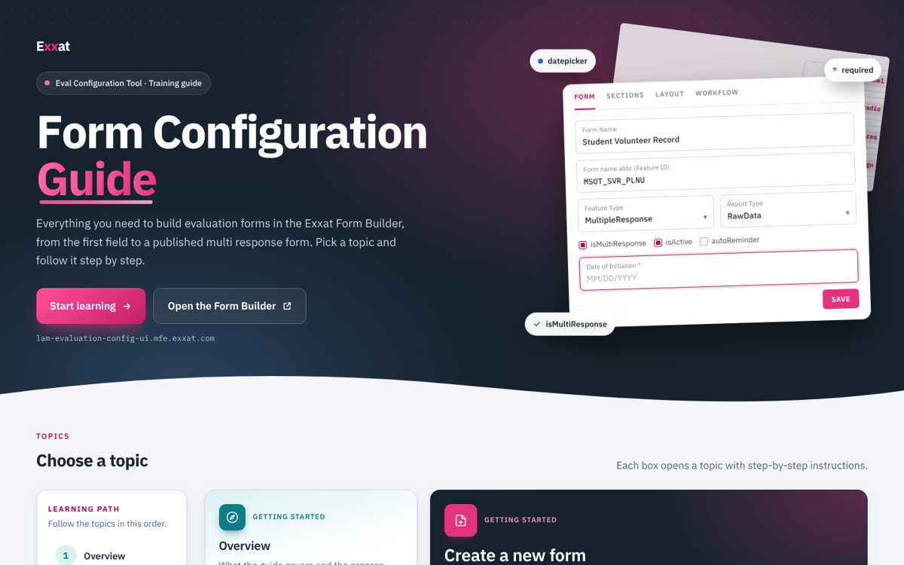

# Exxat Form Configuration Guide

A step-by-step training guide for building evaluation forms in the **Exxat Form Builder** (Eval Configuration Tool).

### 🔗 [Open the guide → muskan01313.github.io/guide](https://muskan01313.github.io/guide/)

---

## Why this guide exists

Form configuration in the Exxat Form Builder has many moving parts: Feature IDs, sections, layouts, workflows, instances, notifications and terms. Until now, new team members mostly learned it by shadowing a colleague or by studying forms that were already built, and the details lived in scattered notes and in people's heads.

This guide puts that knowledge in one place. It was made to:

- **Speed up onboarding.** New joiners can learn the whole process at their own pace, in a clear order, before working on live forms.
- **Give the team one reference.** Anyone can check a setting, a field value or a naming rule in seconds instead of asking around.
- **Reduce configuration mistakes.** Common slip-ups, such as invalid Feature IDs, a summary left on the wrong type or a mismatched template ID, are called out where they happen.
- **Keep the process consistent.** Everyone follows the same steps, naming rules and tested workflows.

## Who it is for

| Reader | How to use it |
|---|---|
| **New joiners** | Follow the numbered **Learning path** on the home page, from Overview to Terms. |
| **The configuration team** | Open the topic you need and use its steps, tables and checklists as a quick reference. |
| **Reviewers and leads** | Use it as the agreed standard when checking a configured form. |

## What's inside

| # | Topic | What it covers |
|---|---|---|
| 1 | **Overview** | What the guide covers and the process from start to finish |
| 2 | **Create a new form** | Creating a form or duplicating an existing one, Feature ID and version naming rules, and the Form, Sections, Layout and Workflow tabs |
| 3 | **Control types** | Every field type you can add to a question, from textbox to formula |
| 4 | **Instance-based forms** | Setting up one instance per actor, start to finish |
| 5 | **Multi response forms** | MultipleResponse, isMultiResponse and the first date field |
| 6 | **Multi-preceptor forms** | One section with Multi Instance, and RecordSummary.SelectPreceptorSection on every summary |
| 7 | **Notifications** | Emails sent to stakeholders at each stage of the workflow, with fusion templates |
| 8 | **Terms** | Adding a midterm and a final term on the Terms tab and linking each to its instances |
| 9 | **Tested workflows** | Six tested workflows with their steps and buttons, ready to copy or download as a Word file |
| 10 | **Glossary** | Every Form Builder term in one list |

## Features

- **Real screenshots** from the Form Builder, with numbered figures you can click to enlarge
- **"Steps at a glance"** lists at the start of each topic, followed by detailed instructions
- **Field-by-field tables** and **checklists** showing exactly what to enter
- **Copy and download buttons** for JSON templates and workflows
- **A built-in Feature ID checker** that flags characters that are not allowed
- **Works everywhere:** desktop, tablet and phone, in light and dark mode
- **Works offline:** the guide is a single file with all images and downloads built in, so it can be saved and opened without internet

## Feedback and updates

This is a living guide. Please get in touch if:

- something is out of date or doesn't match what you see in the Form Builder
- a step, field or form type is missing or unclear
- a new requirement comes up that the guide should cover

The guide will keep being updated and enhanced based on feedback and new requirements.

## Credits

- Guide created and maintained by **Muskan Sharma**

---

### For maintainers

The whole guide is one self-contained HTML file, and GitHub Pages publishes it from the `main` branch.

| File | Purpose |
|---|---|
| `index.html` | The guide. This is what the site shows. |
| `Exxat-Form-Configuration-Guide.html` | A copy of the same guide, kept so older links keep working |
| `assets/preview.png` | The screenshot at the top of this README |

To publish an update, replace **both** HTML files with the new version and push to `main`. The site updates within a minute or two.
